# DDS — Architektur-Grundlagen

**Status:** Arbeitsdokument  
**Stand:** 22.11.2026  
**Kontext:** DDS-Seminar; Hauptbeispiel modulare Roboter-Assembly-Zelle, Transferfall UMAA

Sammlung grundlegender Begriffe und Architekturprinzipien zu DDS, DDSI-RTPS und deren Einsatz in verteilten Automatisierungssystemen. Die Assembly-Zelle ist das einzige ausgearbeitete Anwendungsbeispiel; UMAA für unbemannte maritime Fahrzeuge dient als knapper Transferfall. Krankenhaus und autonomes Fahren sind aus dem Vortragsumfang ausgeschlossen. Die Darstellung des Paketwegs dient der Einordnung in das OSI-Modell. Sie ist kein Nachweis für harte Echtzeit oder funktionale Sicherheit.

## 1. DDS: Überblick und Datenmodell

**DDS** (*Data Distribution Service*) ist ein OMG-Standard für datenzentrische Kommunikation zwischen verteilten Anwendungen. Anwendungen veröffentlichen typisierte Daten zu **Topics**; andere Anwendungen abonnieren die Topics, die sie benötigen. Sender und Empfänger müssen einander nicht direkt adressieren.

Beispiel: Die Motion/PLC-Steuerung veröffentlicht `JointState`. Die Robotersteuerung und das Edge-Gateway können diesen Datenstrom abonnieren. Die DDS-Middleware vermittelt die Daten anhand von Topic, Datentyp und vereinbarten QoS-Eigenschaften. Das logische Modell wird häufig **Global Data Space** genannt; es bedeutet nicht, dass alle Teilnehmer denselben physischen Speicher teilen. [1]

DDS ist ein Standard und keine einzelne Implementierung. Produkte wie Fast DDS und Cyclone DDS implementieren DDS; für Interoperabilität über Herstellergrenzen hinweg ist auch das standardisierte Wire-Protokoll DDSI-RTPS relevant.

## 2. UDP und Verbindungslosigkeit

UDP (*User Datagram Protocol*) ist ein **verbindungsloses** (*connectionless*) Transportprotokoll. Vor dem Senden wird keine Verbindung mit Handshake aufgebaut. UDP selbst bestätigt weder die Zustellung noch die Reihenfolge und verhindert keine Duplikate. Es bietet außerdem **keine Verschlüsselung**. [3]

Das bedeutet **nicht**, dass Kommunikation zwangsläufig öffentlich oder ungeschützt ist. Wer Daten erreichen kann, hängt unter anderem von Adressierung, Netzsegmentierung und Firewall-Regeln ab. Verschlüsselung und Authentisierung müssen durch passende Sicherheitsmechanismen ergänzt werden.

DDS kann trotzdem zuverlässige Übertragung anbieten: Bei DDSI-RTPS können Protokollmechanismen wie Bestätigungen und Wiederholungen Verluste erkennen und behandeln. Das ist eine Funktion oberhalb von UDP und keine Eigenschaft von UDP selbst. Sie garantiert jedoch nicht automatisch, dass Daten innerhalb einer Frist ankommen oder von der Anwendung korrekt verarbeitet werden.

## 3. DDS, DDSI und RTPS

### 3.1 DDS und DCPS

Der zentrale DDS-Kommunikationsansatz heißt **DCPS** (*Data-Centric Publish-Subscribe*). Anwendungen arbeiten unter anderem mit Topics, Publishern, Subscriber, DataWritern und DataReadern. QoS-Policies beschreiben gewünschte Eigenschaften des Datenflusses, beispielsweise Zuverlässigkeit und History. [1]

### 3.2 RTPS

**RTPS** steht für *Real-Time Publish-Subscribe Protocol*. Es ist ein Wire-Protokoll: Es beschreibt, wie DDS-Implementierungen Protokollnachrichten über einen Transport austauschen. Dazu gehören Nutzdaten sowie Steuer- und Discovery-Nachrichten. Der Name „Real-Time“ ist **keine** Garantie für harte Echtzeit; die erreichbare Latenz hängt auch von Betriebssystem, Implementierung, Netz, Last und Konfiguration ab.

### 3.3 DDSI

**DDSI** steht für *DDS Interoperability*. **DDSI-RTPS** ist der Name der OMG-Spezifikation des DDS-Interoperabilitäts-Wire-Protokolls. Ihr Zweck ist, Interoperabilität zwischen DDS-Implementierungen verschiedener Hersteller zu ermöglichen, sofern diese passende Konformität und kompatible Konfigurationen unterstützen. Die aktuell geprüfte formale Ausgabe ist DDSI-RTPS 2.5. [2]

**Abgrenzung:** **DDS** beschreibt die DDS-Schnittstelle und das Datenverteilungsmodell; **DDSI-RTPS** beschreibt ein standardisiertes Protokoll für den Austausch auf der Leitung.

## 4. Paketweg im OSI-Modell

Bei einem typischen Netzwerktransport über UDP ruft die Motion-Anwendung `DataWriter.write(JointState)` auf. Der Datenwert wird serialisiert und in Protokoll- und Netzwerkkapselungen übertragen. Die Zuordnung zu OSI-Schichten ist eine Orientierung: DDS und RTPS lassen sich nicht überall exakt einer einzelnen OSI-Schicht zuordnen.

```mermaid
flowchart LR
    subgraph S[Sender]
        A[Anwendung<br/>DataWriter.write JointState<br/>OSI 7]
        B[DDS DCPS<br/>Topic, QoS, Writer-History<br/>OSI 7]
        C[CDR-Serialisierung<br/>typisierte Daten als Bytes<br/>ungefähr OSI 6]
        D[DDSI-RTPS<br/>DATA und ggf. Steuerdaten<br/>nahe OSI 7]
        E[UDP-Datagramm<br/>Ports, verbindungsloser Transport<br/>OSI 4]
    end

    subgraph N[Netzwerk]
        F[IP-Paket<br/>Quell- und Ziel-IP<br/>OSI 3]
        G[Ethernet-Frame oder anderes Link-Format<br/>z. B. MAC-Adressen<br/>OSI 2]
        H[Signale auf dem Medium<br/>Kupfer, Glasfaser oder Funk<br/>OSI 1]
    end

    subgraph R[Empfänger]
        I[Empfangssignale<br/>OSI 1]
        J[Link-Frame wird entfernt<br/>OSI 2]
        K[IP-Paket wird verarbeitet<br/>OSI 3]
        L[UDP-Datagramm wird dem Port zugeordnet<br/>OSI 4]
        M[DDSI-RTPS verarbeitet Nachricht<br/>ggf. Fragmente und Zuverlässigkeitslogik]
        O[CDR-Deserialisierung<br/>Bytes zurück in typisierte Daten]
        P[DDS DataReader-Cache<br/>Topic und QoS]
        Q[Anwendung liest oder nimmt Sample<br/>OSI 7]
    end

    A --> B --> C --> D --> E --> F --> G --> H
    H --> I --> J --> K --> L --> M --> O --> P --> Q

    B -.->|Discovery und Endpunktinformationen| P
    D -.->|RTPS-Bestätigungen und Wiederholungen bei RELIABLE| M
```

**Interpretation:** Auf dem Sender wird der Datenwert schrittweise verpackt („Kapselung“); auf dem Empfänger werden die jeweiligen Hüllen entfernt („Entkapselung“). Discovery tauscht Teilnehmer- und Endpunktinformationen aus, damit passende Writer und Reader einander finden können. Bei `RELIABLE` können RTPS-Steuernachrichten wie Bestätigungen und Wiederholungen hinzukommen. Die genaue Umsetzung und der unterstützte Transport hängen von der DDS-Implementierung ab. [1][2]

OSI-Schicht 5 (*Sitzung*) hat in diesem vereinfachten DDSI-RTPS-Ablauf keine eigene, direkte Entsprechung. Discovery und die Lebenszyklen von DDS-Entitäten sind DDS-/RTPS-Funktionen, nicht einfach eine separate OSI-Sitzungsschicht.

## 5. Unicast und Multicast

**Unicast** ist die Übertragung von einem Sender an eine konkrete Netzadresse. Bei DDS kann das beispielsweise ein Writer sein, der Daten an einen bekannten Reader-Teilnehmer sendet.

**Multicast** ist die Übertragung an eine Empfängergruppe. Ein Sender schickt dabei typischerweise eine Kopie an eine Multicast-Adresse; das Netz verteilt sie an die Empfänger, die der Gruppe angehören. Das ist nicht dasselbe wie Broadcast an alle Geräte. Multicast muss vom Netzwerk und der Konfiguration unterstützt werden.

Unicast und Multicast beschreiben **Adressierung bzw. Verteilung**, nicht Sicherheit oder Zuverlässigkeit. Multicast ist nicht automatisch „offen“; Unicast ist nicht automatisch sicher. DDS-Implementierungen können je nach Discovery, QoS, Netzwerk und Konfiguration beide Verfahren einsetzen.

## 6. Einsatzgebiete und Grenzen

DDS eignet sich insbesondere für verteilte Anwendungen, die typisierte Datenströme austauschen und dabei nicht direkt voneinander abhängig sein sollen. Im Seminar stehen folgende Beispiele im Fokus:

- **Hauptbeispiel — Assembly-Zelle:** Zustände, Messwerte, Vision-Ergebnisse und Alarme zwischen Robotersteuerung, Motion/PLC, Vision und Edge.
- **Transferfall — UMAA:** Die öffentliche UMAA-Beschreibung benennt OMG DDS als Kernbestandteil der Kommunikation zwischen Autonomiekomponenten an Bord unbemannter maritimer Fahrzeuge. Dieses Beispiel belegt einen konkreten Einsatzbereich, nicht eine universelle Verbreitung in Defense-Systemen. [5]
- Allgemein: verteilte Systeme mit mehreren Datenproduzenten und -konsumenten sowie unterschiedlichen Anforderungen an Aktualität, Zuverlässigkeit oder History.

DDS ist nicht automatisch die beste Wahl für jeden Request/Response-Aufruf, jede Datenbanktransaktion oder jede Cloud-Anbindung. Die Architektur muss den zusätzlichen Aufwand für Datenmodell, QoS, Discovery, Netzkonfiguration und Betrieb rechtfertigen.

## 7. Übertragungszuverlässigkeit und sicherheitskritischer Verkehr

Bei der Bewertung sind drei Eigenschaften getrennt zu betrachten:

- **Übertragungszuverlässigkeit:** Übermittlung des Samples gemäß dem Zuverlässigkeitsmechanismus an einen passenden Reader.
- **Fachliche Gültigkeit:** Aktualität, Plausibilität und Vollständigkeit des Werts sowie Zuordnung zum richtigen Prozessschritt.
- **Funktionale Sicherheit:** Entwurf, Umsetzung und Nachweis der Sicherheitsfunktion, einschließlich des Umgangs mit Fehlern und Risiken.

Die DDS-QoS `RELIABLE` kann mit DDSI-RTPS fehlende Daten erkennen und Wiederholungen veranlassen. Sie ist aber **keine pauschale Ende-zu-Ende-Garantie** für Frist, Anwendungsausführung oder fachliche Korrektheit. `BEST_EFFORT` verzichtet auf diese DDS-Zuverlässigkeitsmechanismen. Eine `DEADLINE`-Policy kann eine erwartete Aktualisierungsfrist ausdrücken und deren Verletzung melden; sie macht ein gewöhnliches Netzwerk nicht automatisch deterministisch. [1][2]

Für sicherheitskritische Funktionen reichen daher weder UDP noch `RELIABLE` allein. Erforderlich sind eine passende, geprüfte Systemarchitektur, begründete Fehler- und Zeitbudgets, Validierung der Daten in der Anwendung und ein nach dem einschlägigen Safety-Prozess geführter Nachweis. Je nach Sicherheitsanforderung kann die Schutzfunktion über eine dafür vorgesehene Safety-Steuerung bzw. einen geeigneten Safety-Kommunikationspfad realisiert werden; DDS kann daneben Betriebs-, Diagnose- oder nicht-sicherheitsgerichtete Prozessdaten transportieren.

**Cybersecurity ist nochmals eine andere Frage:** DDS Security ergänzt Mechanismen wie Authentisierung, Zugriffskontrolle und Kryptografie. Diese schützen gegen bestimmte Angriffe, ersetzen aber keine funktionale Sicherheitszertifizierung und machen Daten nicht automatisch fachlich gültig. [4]

## 8. Zusammenfassung

- UDP heißt **verbindungslos**, nicht automatisch öffentlich oder unsicher.
- UDP allein bestätigt keine Zustellung; DDSI-RTPS kann darüber eigene Zuverlässigkeitsmechanismen einsetzen.
- `RELIABLE` bedeutet nicht „rechtzeitig, fachlich korrekt und sicher verarbeitet“.
- Unicast und Multicast sagen, **an wen** Daten adressiert werden, nicht ob sie sicher sind.
- DDS unterstützt Echtzeit-Anforderungen; harte Echtzeit oder funktionale Sicherheit entstehen nicht allein durch die Wahl von DDS.

## 9. Quellen

Die Versionsangaben und Links wurden am 22.11.2026 geprüft. Für technische Aussagen sind die OMG-Spezifikationen maßgeblich; Herstellerdokumentation kann zusätzlich konkrete Implementierungsdetails erklären.

1. Object Management Group (OMG), **Data Distribution Service (DDS), Version 1.4**, formal, März 2015: <https://www.omg.org/spec/DDS/1.4/PDF>
2. OMG, **DDS Interoperability Wire Protocol (DDSI-RTPS), Version 2.5**, formal, April 2022: <https://www.omg.org/spec/DDSI-RTPS/2.5/PDF>
3. J. Postel, **RFC 768: User Datagram Protocol**, August 1980: <https://www.rfc-editor.org/rfc/rfc768>
4. OMG, **DDS Security, Version 1.2**, formal, Februar 2026: <https://www.omg.org/spec/DDS-SECURITY/1.2>
5. AUVSI, **Unmanned Maritime Autonomy Architecture (UMAA)**: <https://www.auvsi.org/advocacy/advocacy-initiatives/unmanned-maritime-autonomy-architecture/>. Öffentliche UMAA-Beschreibung; verweist auf die Compliance-Spezifikation NAVSEA T0300-BE-IDS-010 Rev. 1: <https://www.auvsi.org/wp-content/uploads/2025/03/T0300-BE-IDS-010-Rev.-1.pdf>.

## 10. Fachbegriffe

- **Best Effort:** QoS-Zuverlässigkeitsmodus, bei dem DDS keine zuverlässige Zustellung über Wiederholungsmechanismen zusichert.
- **CDR (Common Data Representation):** standardisierte Byte-Darstellung typisierter Daten, die bei der Serialisierung und Deserialisierung verwendet wird.
- **DCPS (Data-Centric Publish-Subscribe):** DDS-Kommunikationsmodell, in dem Daten über Topics publiziert und abonniert werden.
- **DataReader:** DDS-Entität, über die eine Anwendung Daten eines Topics empfängt und aus dem Reader-Cache liest oder entnimmt.
- **DataWriter:** DDS-Entität, über die eine Anwendung typisierte Daten zu einem Topic publiziert.
- **DDS (Data Distribution Service):** OMG-Standard für datenzentrische Publish/Subscribe-Middleware.
- **DDSI (DDS Interoperability):** Bezeichnung für die DDS-Interoperabilität; Bestandteil des Spezifikationsnamens DDSI-RTPS.
- **DDSI-RTPS:** OMG-Wire-Protokoll zur Interoperabilität von DDS-Implementierungen.
- **Discovery:** DDS-/RTPS-Mechanismen, mit denen Teilnehmer und passende Publisher-/Subscriber-Endpunkte einander finden und beschreiben.
- **DomainParticipant:** DDS-Entität, die eine Anwendungsteilnahme an einer DDS-Domain repräsentiert und weitere DDS-Entitäten verwaltet.
- **Global Data Space:** logisches Modell eines gemeinsam zugänglichen Datenraums; kein gemeinsamer physischer Speicher.
- **Kapselung / Entkapselung:** Verpacken von Daten mit Protokollinformationen auf dem Sender und Entfernen dieser Hüllen auf dem Empfänger.
- **Multicast:** Übertragung an eine Empfängergruppe, nicht automatisch an jedes Gerät im Netzwerk.
- **OSI-Modell:** Referenzmodell mit sieben Schichten zur Beschreibung von Kommunikationsfunktionen in Netzwerken.
- **QoS (Quality of Service):** konfigurierbare DDS-Eigenschaften und Anforderungen eines Datenflusses, etwa Zuverlässigkeit, History und Deadline.
- **Reliable:** DDS-QoS-Zuverlässigkeitsmodus, bei dem die Middleware mithilfe des Protokolls fehlende Samples erkennen und Wiederholungen veranlassen kann; keine allgemeine Frist- oder Sicherheitsgarantie.
- **RTPS (Real-Time Publish-Subscribe Protocol):** Wire-Protokoll, das DDS-Nutzdaten sowie Steuer- und Discovery-Nachrichten transportiert.
- **Topic:** benannter, typisierter Datenstrom, den Publisher beschreiben und Subscriber abonnieren.
- **UMAA (Unmanned Maritime Autonomy Architecture):** Architekturinitiative für modulare und skalierbare Software unbemannter maritimer Fahrzeuge; laut öffentlicher UMAA-Beschreibung ist OMG DDS ein Kernbestandteil der Kommunikation zwischen Autonomiekomponenten an Bord.
- **UDP (User Datagram Protocol):** verbindungsloses Transportprotokoll; es stellt selbst keine zuverlässige, geordnete oder verschlüsselte Zustellung sicher.
- **Unicast:** Übertragung an eine konkrete Empfängeradresse.
- **Writer-/Reader-History:** von DDS verwaltete Samples auf der Publisher- bzw. Subscriber-Seite; Aufbewahrung und Umfang hängen unter anderem von QoS ab.
