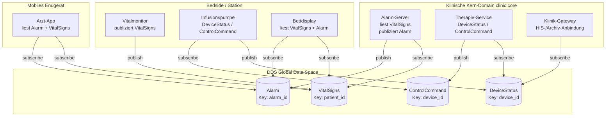
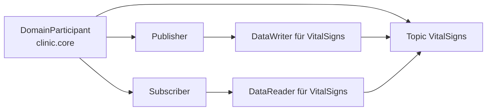
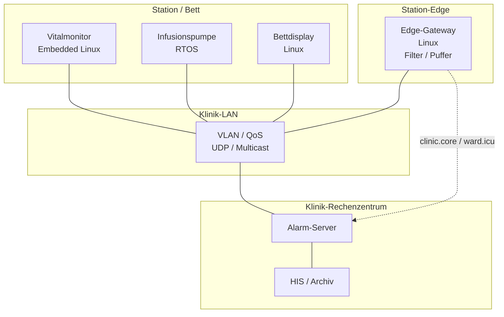
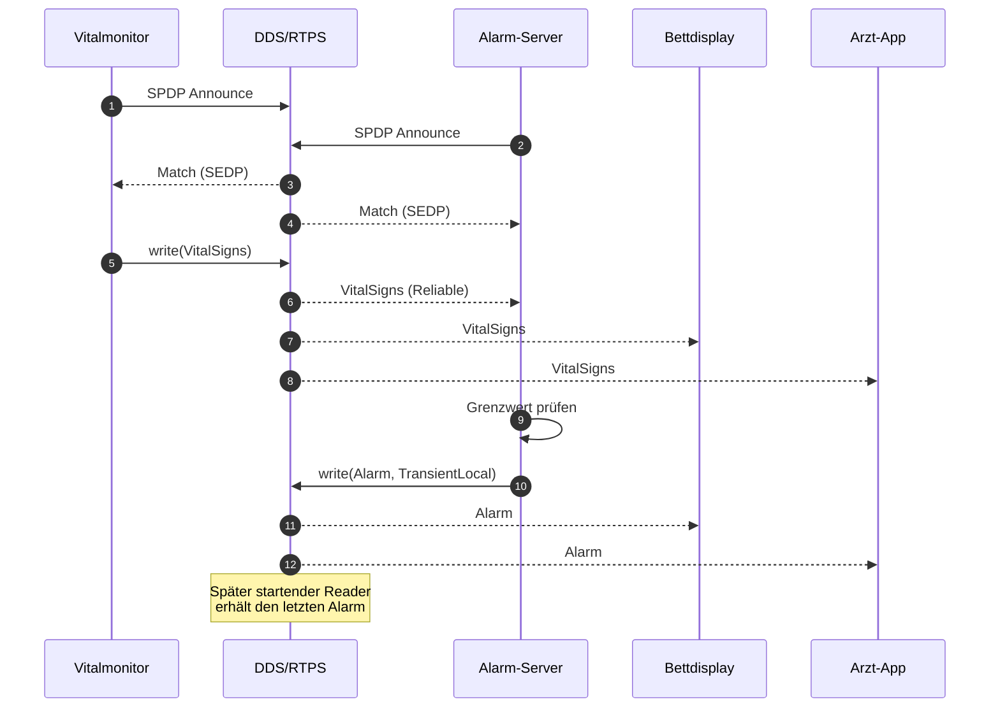
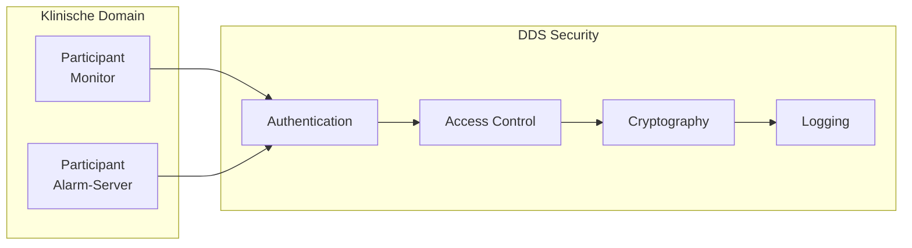

# Variante A — Architektur v0.1: DDS im automatisierten Krankenhaus

**Status:** erster Mermaid-Entwurf, nicht final  
**Grundlage:** `01_plan/Projektvarianten.md`, Variante A  
**Domäne:** automatisiertes Krankenhaus (Vitaldaten, Alarme, Geräteintegration)  
**Ziel:** Architekturstruktur für den Seminarvortrag und die schriftlichen Unterlagen

> **Hinweis:** Die Diagramme sind bewusst als erste Struktur angelegt. QoS-Werte, Sicherheitsdetails und die HL7/FHIR-Abgrenzung sind noch zu validieren.

---

## 1. Annahmen

- DDS ist die Kommunikationsschicht; es gibt **keinen zentralen Broker**.
- Klinische Domains sind logisch getrennt: `clinic.core`, `ward.icu`, `ward.normal`, `building.technical`.
- Patientendaten verlassen die klinische Domain nicht; Gebäudetelemetrie ist getrennt.
- Die Demo zeigt nur einen Ausschnitt (Vitaldaten + Alarm), nicht das gesamte Krankenhaus.

---

## 2. Kontext- und Komponentensicht

**Lesart:** Die Anwendungen kennen nur Topics und QoS, nicht die Netzwerkadressen der anderen Teilnehmer. Domains/Partitions begrenzen die Sichtbarkeit; DDS Discovery verbindet passende Writer und Reader.

---

## 3. DDS-Grundmodell im Beispiel

Das Modell wiederholt sich für `Alarm`, `DeviceStatus` und `ControlCommand`. Jede Entität besitzt eine QoS-Konfiguration; Writer und Reader müssen im RxO-Matching kompatibel sein.

---

## 4. QoS-Zuordnung

| Topic | Key | Ziel-QoS | Begründung |
|---|---|---|---|
| `VitalSigns` | `patient_id` | Reliable, KeepLast(1–5), Deadline 100 ms | Messwerte müssen ankommen; kurze Historie für späte Reader |
| `Alarm` | `alarm_id` | Reliable, TransientLocal, Deadline 50 ms, Liveliness | Alarme dürfen nicht verloren gehen; späte Teilnehmer sehen den letzten Alarm |
| `DeviceStatus` | `device_id` | BestEffort, KeepLast(1) | Status ist schnell ersetzbar |
| `ControlCommand` | `device_id` | Reliable, Lifespan, Ownership | Befehle brauchen Eindeutigkeit und Verfallszeit |

> Die Werte sind **Zielwerte für die Diskussion**, keine gemessenen Garantien.

---

## 5. Deployment-Sicht

**Anmerkung:** Das Edge-Gateway bündelt und filtert Daten, ersetzt aber nicht die DDS-Domains. Die Domain-/Partition-Struktur bleibt die primäre Isolationsgrenze.

---

## 6. Sequenz: Vitaldaten und Alarm

---

## 7. Security-Skizze

**Threat-Szenario:** Ein fremder Participant gibt sich als Monitor aus und publiziert falsche `VitalSigns`. Authentication und Access Control verhindern die Teilnahme; Encryption schützt vertrauliche Daten; Logging macht Zugriffe nachvollziehbar.

**Grenze:** DDS Security ersetzt keine klinische Zertifizierung und keine Datenschutz-Folgenabschätzung.

---

## 8. Offene Punkte für v0.2

- Genaue Domain-/Partition-Aufteilung (Station vs. Klinik vs. Gebäude).
- QoS-Werte mit dem Team validieren; Deadline/Liveliness begründen.
- HL7/FHIR-Abgrenzung: Wo endet DDS, wo beginnt klinische Interoperabilität?
- Security: PKI, Zertifikatsverteilung, Schlüsselmanagement, Audit.
- Deployment: konkrete Geräte, RTOS-Annahmen, Netzsegmente.
- Demo: nur `VitalSigns` + `Alarm` oder zusätzlich `DeviceStatus`?
