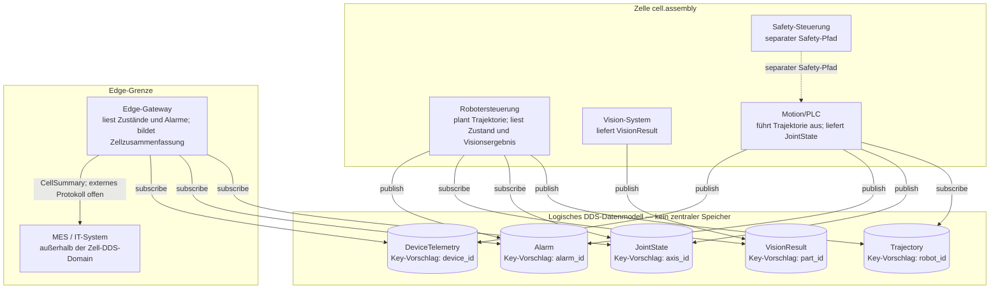
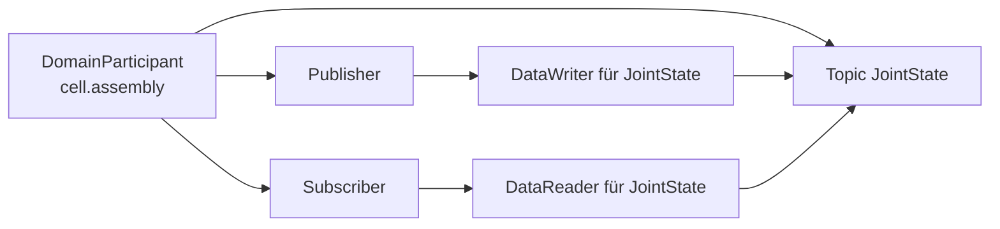
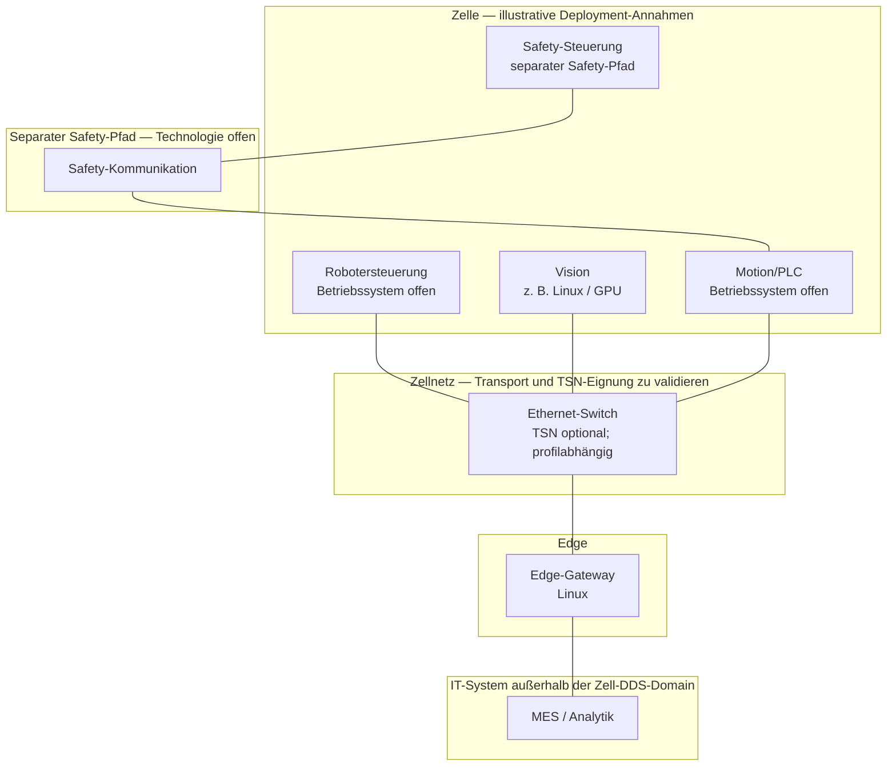
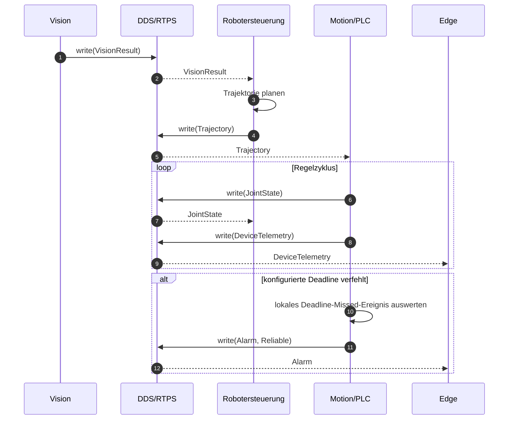
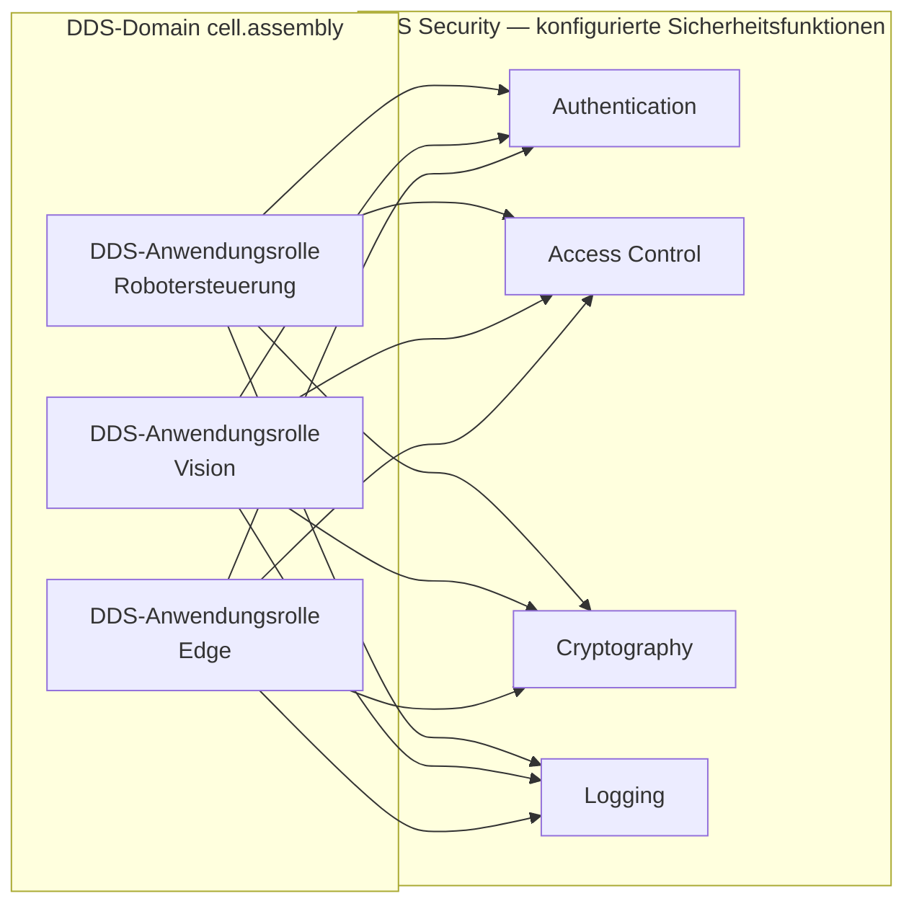

# Architektur v0.2 — DDS in einer modularen Roboter-Assembly-Zelle

**Status:** Hauptbeispiel für den Architekturteil, Revisionsstand v0.2; QoS und Deployment noch nicht abschließend validiert  
**Grundlage:** gewählter Seminar-Scope, vormals `01_plan/Projektvarianten.md`, Variante B  
**Domäne:** Smart Factory / Motion Control — Roboter, Vision, Motion/PLC, Edge, MES  
**Ziel:** Architekturstruktur für den Seminarvortrag und die schriftlichen Unterlagen

> **Scope:** Die DDS-Referenzarchitektur wird an der Assembly-Zelle erklärt. Als kurzer Transferfall dient UMAA für unbemannte maritime Fahrzeuge: DDS ist dort laut öffentlicher UMAA-Beschreibung ein Kernbestandteil der Kommunikation zwischen Autonomiekomponenten an Bord [3][4]. UMAA erhält keine zweite vollständige Architektur.

> **Abgrenzung:** Krankenhaus und autonomes Fahren sind nicht Teil des gewählten Vortragsumfangs. Die vorhandene Krankenhausdatei bleibt als ausgeschlossener Arbeitsentwurf erhalten. Eine reale Zellenimplementierung wird hier nicht behauptet; die Zelle ist ein begründetes Referenzszenario.

---

## 1. Annahmen

- DDS/DCPS stellt die datenzentrische Publish/Subscribe-Kommunikation bereit. Für das Beispiel wird kein zentraler Nachrichtenbroker als Vermittler angenommen; Discovery und Deployment sind implementierungs- und konfigurationsabhängig.
- Die Darstellung fokussiert auf `cell.assembly`. Weitere Domains oder Partitions werden nicht ohne konkreten Isolationsbedarf vorausgesetzt.
- Die Safety-Funktion liegt außerhalb der dargestellten DDS-Datenflüsse. Eine etwaige Statusweitergabe über DDS wäre nicht-sicherheitsgerichtete Diagnoseinformation und ist hier nicht modelliert.
- Die MES-Anbindung endet in dieser AP1-Sicht an der Edge-Grenze. MES wird nicht als DDS-Teilnehmer der Zell-Domain angenommen; das externe Protokoll ist noch festzulegen.
- Die Demo zeigt einen Ausschnitt (JointState, Trajectory, Alarm), nicht die gesamte Zelle.

---

## 2. Kontext- und Komponentensicht

**Lesart:** Topic-Knoten stellen logische Datenströme dar, keinen zentralen DDS-Server oder gemeinsamen physischen Speicher. Das Edge-Gateway liest Betriebsdaten und Alarme; es publiziert im dargestellten DDS-Datenmodell nicht zurück in dieselben Topics. Der MES-Übergang ist eine Systemgrenze, keine festgelegte DDS-Verbindung. Die Safety-Linie ist separat und nicht Teil der DDS-Datenverteilung.

Die Komponenten sind fachliche Rollen, nicht automatisch gleich viele DDS-`DomainParticipant`-Instanzen. Die konkrete Zuordnung von Prozessen, Geräten und `DomainParticipant`s gehört in die spätere Deployment-Entscheidung.

---

## 3. DDS-Grundmodell im Beispiel

Das Modell wiederholt sich für `Trajectory`, `VisionResult`, `Alarm` und `DeviceTelemetry`. Ein `Topic` benennt einen typisierten Datenstrom; es ist kein zentraler Speicherort. Die konkrete Anwendungsprozess-zu-`DomainParticipant`-Zuordnung bleibt offen. Writer und Reader benötigen kompatible QoS-Einstellungen, soweit für die jeweiligen Policies Requested/Offered Matching gilt.

---

## 4. QoS-Zuordnung

| Topic | Key | Ziel-QoS | Begründung |
|---|---|---|---|
| `JointState` | `axis_id` | BestEffort, KeepLast(1); Deadline als zu prüfendes Ziel | Zyklische Zustandsdaten; Aktualität kann wichtiger sein als Nachlieferung |
| `Trajectory` | `robot_id` | Reliable, begrenzte History; Deadline als zu prüfendes Ziel | Vollständigkeits- und Gültigkeitsanforderungen fachlich spezifizieren |
| `VisionResult` | `part_id` | Reliable, begrenzte History; Frist abhängig vom Prozess | Ergebnis muss dem richtigen Werkstück/Zyklus zugeordnet sein |
| `Alarm` | `alarm_id` | Reliable; Durability/History anhand des Alarm-Lebenszyklus festlegen | Aufbewahrung und späte Leser sind fachlich zu entscheiden |
| `DeviceTelemetry` | `device_id` | BestEffort, KeepLast(1) als Startannahme | Monitoring kann je nach Auswertung Verluste tolerieren |

> Die QoS-Zuordnungen sind **Entwurfshypothesen**, keine validierten Werte oder Garantien. Zahlenwerte werden erst nach Festlegung von Zyklus, Frist und Verlustverhalten eingesetzt. QoS ersetzt weder Anwendungsvalidierung noch ein Zeitbudget. TSN und DDS sind getrennt zu begründen. Safety-Traffic ist in dieser Tabelle ausdrücklich nicht enthalten.

---

## 5. Deployment-Sicht

**Anmerkung:** Das Deployment ist illustrativ, nicht produkt- oder RTOS-validiert. Ein TSN-fähiger Switch allein macht den Datenpfad nicht deterministisch. Die DDS-Domain ist eine logische Kommunikationsgrenze, keine Safety-Zertifizierungsgrenze. Das MES ist außerhalb der dargestellten Zell-DDS-Domain; Protokoll und Datenabbildung am Edge sind offen.

---

## 6. Sequenz: Vision, Trajektorie und Regelzyklus

---

## 7. Security-Skizze

**Threat-Szenario:** Ein nicht autorisierter oder kompromittierter DDS-Teilnehmer versucht, `Trajectory` zu lesen oder zu publizieren. Die dargestellten Rollen sind keine Festlegung auf je einen DDS-`DomainParticipant`. Authentisierung und Zugriffskontrolle können nicht autorisierte Identitäten bzw. nicht erlaubte Datenzugriffe begrenzen; Kryptografie schützt je nach Konfiguration Vertraulichkeit und Integrität; Logging unterstützt die Nachvollziehbarkeit. Ein kompromittierter, aber autorisierter Publisher oder fachlich falsche Daten werden dadurch nicht automatisch erkannt. Der Safety-Pfad ist nicht Gegenstand dieser DDS-Skizze.

**Grenze:** DDS Security schützt Vertraulichkeit, Integrität und Zugriff — nicht die funktionale Safety der Zelle.

---

## 8. Offene Punkte für die nächste Architekturversion

- Komponenten- und Topic-Mapping inklusive Verantwortlichkeit, Typ, Key und Leser/Schreiber abschließen.
- MES-Schnittstelle am Edge festlegen; dabei klären, ob MES nur extern angebunden ist oder separat DDS nutzt.
- Prozess-/Gerätezuordnung zu `DomainParticipant`, Domain und Partition begründen.
- QoS je Datenstrom aus Zyklus, Frist, Verlusttoleranz und History-Anforderung herleiten; Zahlenwerte messen oder als Annahme kennzeichnen.
- TSN-Einsatz, Traffic-Klassen und Zeitbudgets getrennt von DDS-QoS festlegen.
- DDS Security Bedrohungsmodell und Autorisierungsregeln konkretisieren; kompromittierte autorisierte Teilnehmer berücksichtigen.
- Demo-Umfang für `JointState`, `VisionResult` und `Alarm` festlegen.
- UMAA-Transfer auf eine kurze, quellenbasierte Einordnung beschränken; keine Detailarchitektur oder operative Behauptung ergänzen.

## 9. Quellen und Aussagegrenzen

1. Object Management Group (OMG), **Data Distribution Service (DDS), Version 1.4**: <https://www.omg.org/spec/DDS/1.4/PDF> — Primärquelle für DCPS und DDS-Semantik.
2. OMG, **DDS Interoperability Wire Protocol (DDSI-RTPS), Version 2.5**: <https://www.omg.org/spec/DDSI-RTPS/2.5/PDF> — Primärquelle für das Wire-Protokoll.
3. AUVSI, **Unmanned Maritime Autonomy Architecture (UMAA)**: <https://www.auvsi.org/advocacy/advocacy-initiatives/unmanned-maritime-autonomy-architecture/> — öffentliche UMAA-Beschreibung; benennt DDS als Kernbestandteil für die Kommunikation zwischen Autonomiekomponenten an Bord und verlinkt öffentliche Compliance-Unterlagen.
4. NAVSEA, **UMAA Compliance Specification, T0300-BE-IDS-010 Rev. 1**, 30.07.2024: <https://www.auvsi.org/wp-content/uploads/2025/03/T0300-BE-IDS-010-Rev.-1.pdf> — öffentliche Compliance-Spezifikation.

**Aussagegrenze UMAA:** UMAA belegt einen konkreten Architektur-/Standardisierungseinsatz von DDS im Bereich unbemannter maritimer Autonomie. Es belegt nicht, dass DDS für jedes unbemannte Fahrzeug oder jede militärische Anwendung eingesetzt wird. Das UMAA-Beispiel dient ausschließlich dem Architekturtransfer.

**Härtungsfragen für AP1:** Die vorbereiteten Professorfragen und Antwortlinien liegen in [`../07_qa/Fragenbank.md`](../07_qa/Fragenbank.md). Beschlossener Scope und offene Folgearbeit stehen in [`../DDS_offene_Fragen.md`](../DDS_offene_Fragen.md).
