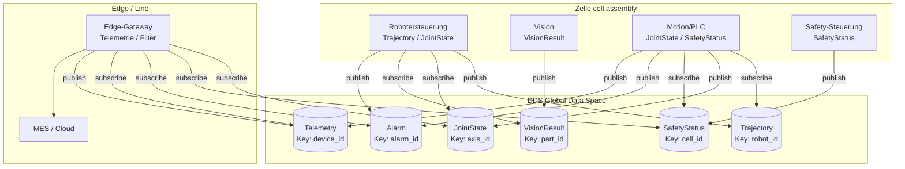
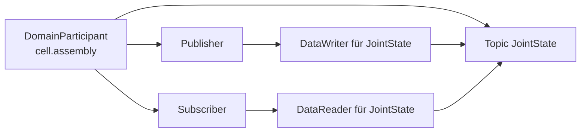
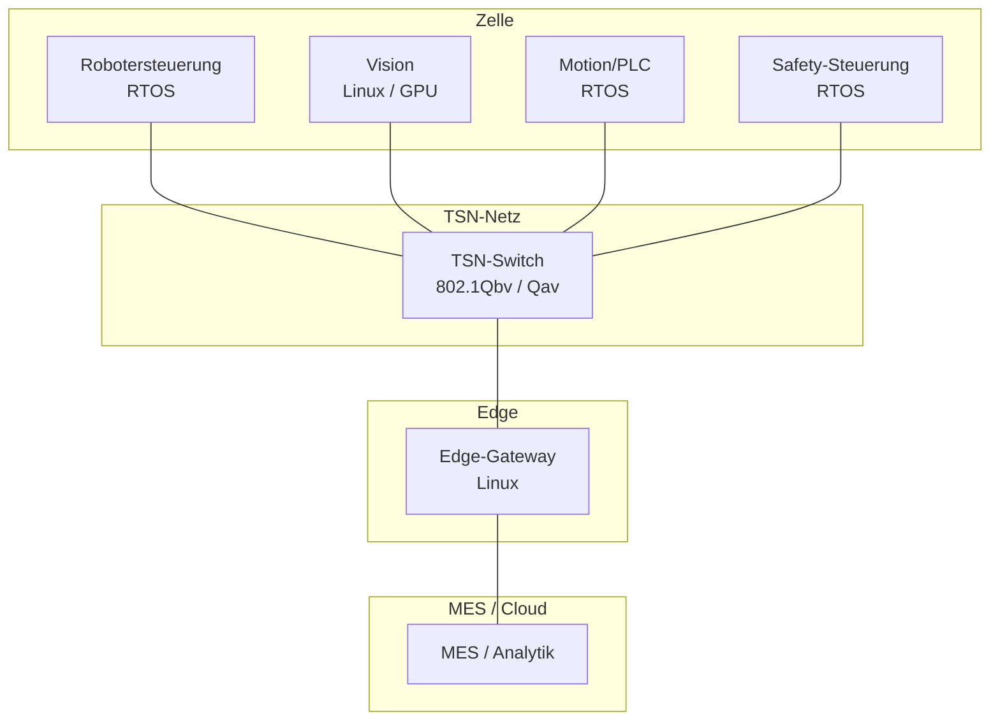
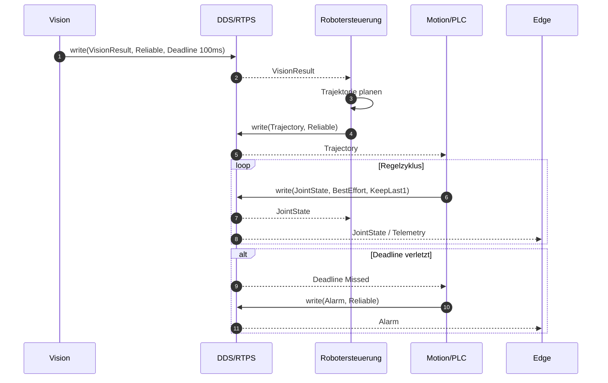
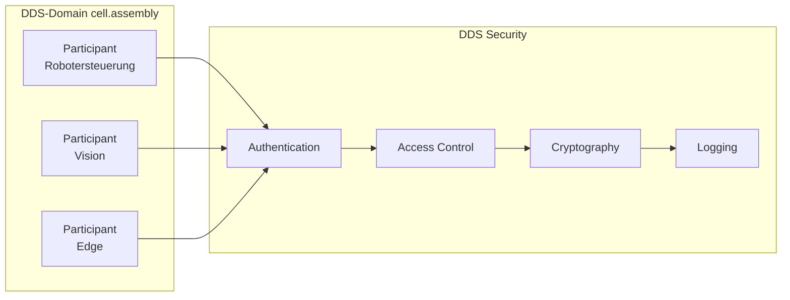

# Variante B — Architektur v0.1: DDS für eine modulare Roboter-Assembly-Zelle

**Status:** erster Mermaid-Entwurf, nicht final  
**Grundlage:** `01_plan/Projektvarianten.md`, Variante B  
**Domäne:** Smart Factory / Motion Control — Roboter, Vision, Motion/PLC, Edge, MES  
**Ziel:** Architekturstruktur für den Seminarvortrag und die schriftlichen Unterlagen

> **Hinweis:** Die Diagramme sind als erste Struktur angelegt. QoS-Werte, TSN-Annahmen und Safety-Grenzen sind noch zu validieren.

---

## 1. Annahmen

- DDS ist die Kommunikationsschicht; es gibt **keinen zentralen Broker**.
- Domains sind logisch getrennt: `cell.assembly`, `line.assembly`, `edge.telemetry`.
- Safety wird als eigener, zertifizierter Pfad betrachtet; DDS Security ersetzt keine Safety-Zertifizierung.
- Die Demo zeigt einen Ausschnitt (JointState, Trajectory, Alarm), nicht die gesamte Zelle.

---

## 2. Kontext- und Komponentensicht

**Lesart:** Die Zelle kommuniziert datenzentriert über Topics. Der Edge-Gateway konsumiert Telemetrie und Alarme, ohne in den harten Regelkreis einzugreifen.

---

## 3. DDS-Grundmodell im Beispiel

Das Modell wiederholt sich für `Trajectory`, `VisionResult`, `SafetyStatus`, `Alarm` und `Telemetry`. Jede Entität besitzt eine eigene QoS-Konfiguration; Writer und Reader müssen im RxO-Matching kompatibel sein.

---

## 4. QoS-Zuordnung

| Topic | Key | Ziel-QoS | Begründung |
|---|---|---|---|
| `JointState` | `axis_id` | BestEffort, KeepLast(1), Deadline 1–5 ms, TransportPriority | Zyklische Regelungsdaten; altes Sample ist wertlos |
| `Trajectory` | `robot_id` | Reliable, KeepLast(1), Deadline 10 ms | Trajektorie muss vollständig ankommen |
| `VisionResult` | `part_id` | Reliable, KeepLast(1), Deadline 50–100 ms | Ergebnis muss zum Werkstück passen |
| `SafetyStatus` | `cell_id` | Reliable, TransientLocal, Deadline 10 ms, Liveliness | Sicherheitsstatus darf nicht verloren gehen |
| `Alarm` | `alarm_id` | Reliable, TransientLocal, Deadline 50 ms | Späte Teilnehmer müssen den letzten Alarm sehen |
| `Telemetry` | `device_id` | BestEffort, KeepLast(1), hoher Durchsatz | Monitoring verträgt Verluste |

> Die Werte sind **Zielwerte für die Diskussion**, keine gemessenen Garantien. TSN und DDS müssen getrennt begründet werden.

---

## 5. Deployment-Sicht

**Anmerkung:** Safety kann physisch über ein eigenes Safety-Netzwerk laufen. Die DDS-Domain `cell.assembly` ist die logische Kommunikationsgrenze, nicht die Safety-Zertifizierungsgrenze.

---

## 6. Sequenz: Vision, Trajektorie und Regelzyklus

---

## 7. Security-Skizze

**Threat-Szenario:** Ein manipulierter Participant sendet falsche `Trajectory`- oder `SafetyStatus`-Daten. Authentication und Access Control verhindern die Teilnahme; Encryption schützt die Domains; Logging macht Zugriffe nachvollziehbar.

**Grenze:** DDS Security schützt Vertraulichkeit, Integrität und Zugriff — nicht die funktionale Safety der Zelle.

---

## 8. Offene Punkte für v0.2

- Genaue Domain-/Partition-Aufteilung (Zelle, Linie, Edge).
- QoS-Werte mit dem Team validieren; Deadline/LatencyBudget begründen.
- TSN: Welche Traffic-Klassen, welche Zeitbudgets, welche Rolle spielt DDS darüber?
- Safety: Wo endet DDS, wo beginnt die Safety-Steuerung?
- Security: PKI, Zertifikatsverteilung, Schlüsselmanagement, Engineering-Zugriff.
- Demo: nur `JointState` + `Alarm` oder zusätzlich `VisionResult`?
- Abgrenzung zu OPC UA Pub/Sub, MQTT und SOME/IP schärfen.
