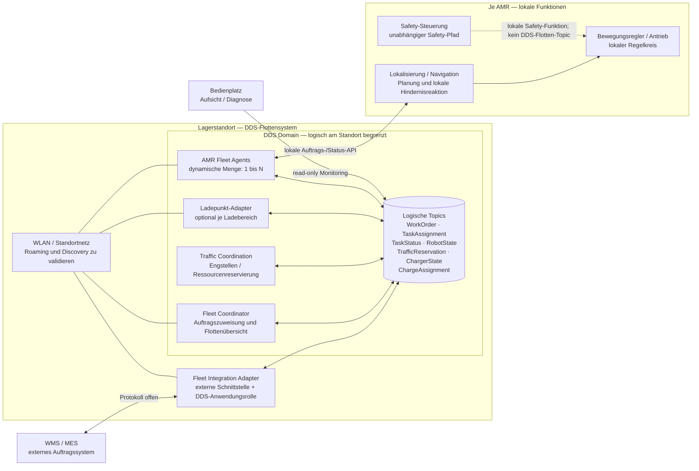
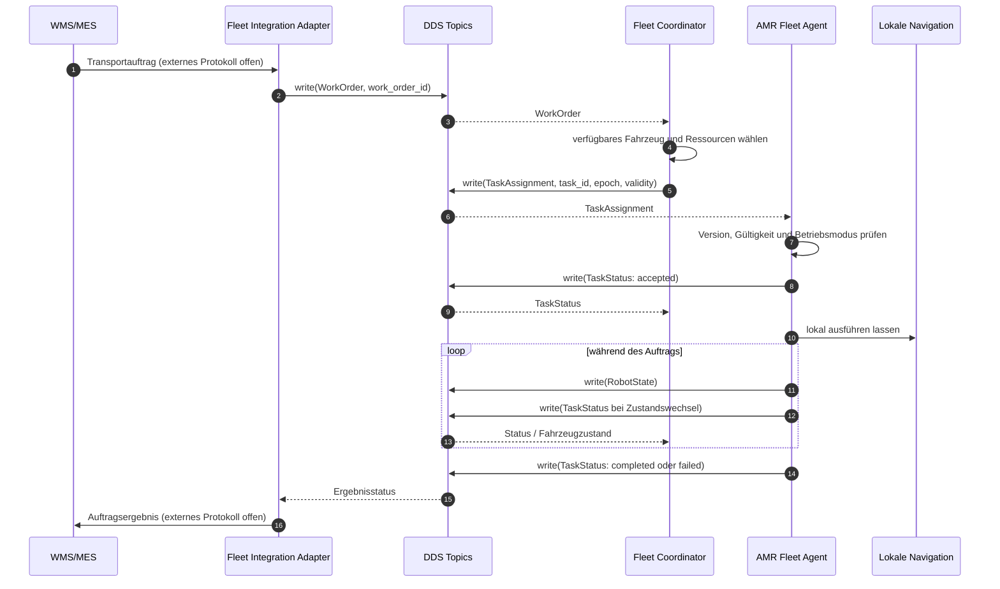
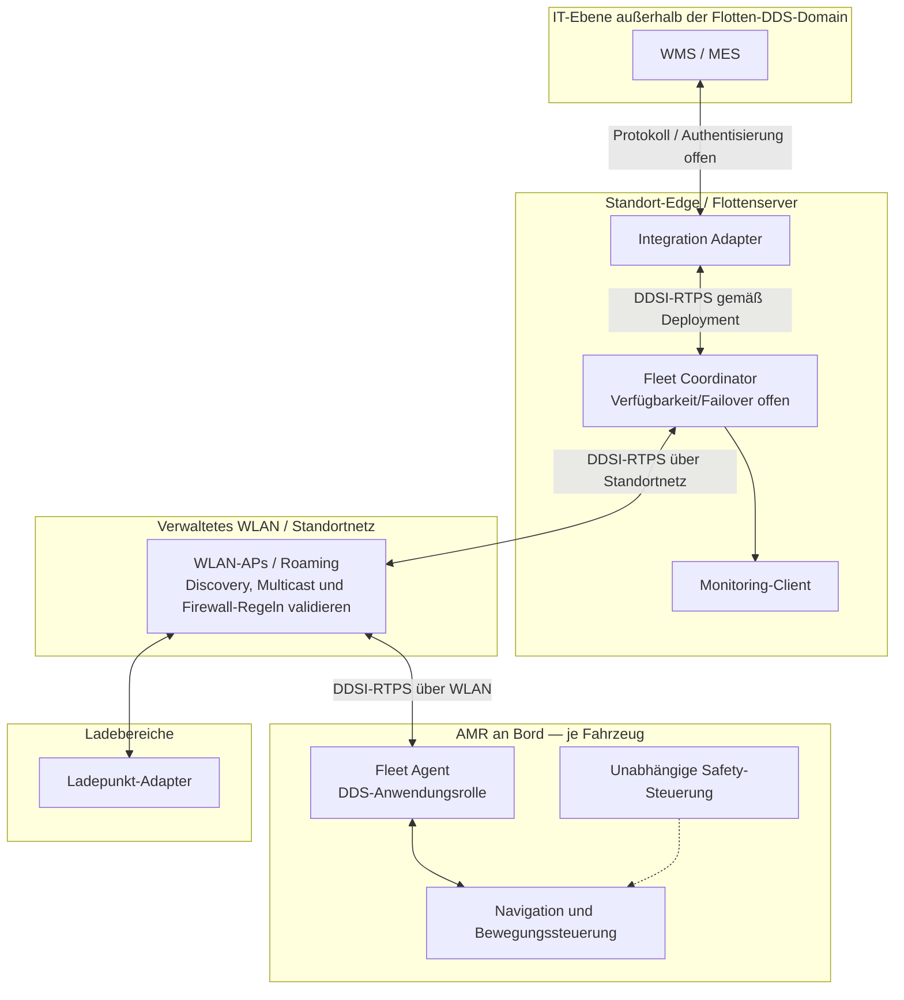

# Architekturentwurf — DDS für eine AMR-Flotte

**Stand:** 25.11.2026  
**Revision:** v0.1  
**Status:** Kandidatenarchitektur für den Vergleich mit der Assembly-Zelle; keine finale Auswahl des Seminar-Hauptbeispiels  
**Rollenbezug:** A — Architektur und roter Faden  
**Umsetzungsprofil:** native DDS-API direkt, ohne ROS 2; DDS-Implementierung noch offen  
**Lizenzanforderung:** FOSS; kommerzielle Erweiterungen sind keine Architekturvoraussetzung  
**Szenario:** Transportroboter (AMR) in einem Lager mit Flottenkoordination, Ladestationen und Anbindung an ein übergeordnetes Auftrags-/Lagersystem

> **Aussagegrenze:** Das folgende Modell ist ein eigenes Referenzszenario, keine Behauptung über eine konkrete AMR-Installation oder einen bestimmten Hersteller. Fachliche Rollen und DDS-`DomainParticipant`s sind nicht automatisch 1:1 zugeordnet. Topic-Namen, QoS und Ausfallverhalten sind Architekturvorschläge und müssen mit Anforderungen sowie Implementierung validiert werden.

## 1. Ziel und Systemgrenze

Die AMR-Flotte erhält Transportaufträge aus einem übergeordneten WMS/MES, verteilt sie auf verfügbare Fahrzeuge und koordiniert die gemeinsame Nutzung von Verkehrsressourcen wie Engstellen oder Ladeplätzen. Die AMRs melden Betriebs- und Auftragszustände zurück.

**Innerhalb des betrachteten Flottensystems:**

- Fleet Coordinator mit Auftragszuweisung und Flottenzustandsübersicht;
- ein Fleet Agent je AMR als DDS-Anwendungsrolle;
- Verkehrskoordination als logische Funktion des Coordinators oder als eigener Dienst;
- optionale Ladepunkt-Adapter und Bedien-/Monitoring-Client;
- Fleet Integration Adapter als Übergang zum externen WMS/MES.

**Außerhalb der DDS-Flottengrenze:**

- WMS/MES und deren Protokoll;
- lokaler Bewegungsregler, Antriebssteuerung und sicherheitsgerichtete Steuerung eines AMR;
- Sensor-/Aktuatorbusse und herstellerspezifische Schnittstellen im Fahrzeug.

Die WMS/MES-Anbindung endet zunächst am Fleet Integration Adapter. Ein externes DDS-Netz wird nicht vorausgesetzt; Protokoll, Authentisierung und Auftragsabbildung an dieser Grenze sind offen.

Für diese Kandidatenarchitektur verwenden Fleet Agent, Fleet Coordinator und Adapter **direkt die DDS-API**. ROS-2-Nodes, ROS Middleware Interface (RMW) und ROS-2-Nachrichten sind nicht Teil des Modells. Die konkrete DDS-Implementierung wird später gewählt; dadurch bleiben die standardisierten DDS-Konzepte erhalten, während Implementierungsdetails hinter einer eigenen schmalen Adapter-/Portgrenze gekapselt werden sollten.

## 2. Annahmen und Entwurfsgrenzen

1. AMRs bewegen sich innerhalb eines abgegrenzten Lager-/Standortnetzes und kommunizieren teilweise über ein drahtloses WLAN mit Roaming. Eine lückenlose Funkabdeckung oder feste Latenz wird nicht angenommen.
2. DDS verteilt Flottenzustände, Aufträge und Koordinationsdaten. DDS ersetzt weder die lokale Navigation noch die Bewegungsregelung.
3. **Funktionale Safety liegt lokal im AMR und außerhalb der dargestellten DDS-Flottenkommunikation.** DDS-Nachrichten dürfen in diesem Modell weder Not-Halt noch Schutzfelder oder andere Safety-Funktionen ersetzen.
4. Der Coordinator ist eine logische Rolle. Hochverfügbarkeit, Redundanz, Leader-Auswahl und Wiederanlauf sind noch zu entscheiden; eine konkrete Failover-Technik wird nicht behauptet.
5. Die Zahl der AMRs ist variabel. Join/Leave, Identität, Neustart und Wiederanmeldung werden als normale Lebenszyklusfälle berücksichtigt.
6. Die konkreten Zykluszeiten, Fristen, Datenmengen und Verlusttoleranzen sind noch nicht spezifiziert. Daher enthält der Entwurf keine numerischen QoS-Werte.

## 3. Kontext- und Komponentensicht

**Lesart:** Der Topic-Knoten zeigt logische DDS-Datenströme, keinen zentralen Broker und keinen zentralen Datenspeicher [1][2]. Der Fleet Coordinator ist eine fachliche Koordinationsrolle; er ist nicht mit DDS-Discovery gleichzusetzen. Der lokale Bewegungs- und Safety-Pfad eines Fahrzeugs bleibt von Flottennachrichten getrennt.

## 4. DDS-Teilnehmer- und Domain-Modell

Die Anwendungsprozesse erzeugen native DDS-Entities: `DomainParticipant`, `Publisher`/`Subscriber`, `Topic`, `DataWriter` und `DataReader`. Das Architekturmodell legt die fachlichen Rollen fest, aber noch nicht abschließend, ob jede Rolle ein eigener Prozess oder mehrere Rollen gemeinsam ein Participant werden. Diese Zuordnung hängt von Prozessgrenzen, Ressourcen, Sicherheitsidentitäten und Ausfallverhalten ab.

| Logische Rolle | DDS-Rolle | Aufgabe | Zuordnungsentscheidung |
|---|---|---|---|
| Fleet Integration Adapter | Writer/Reader für Auftragsübergabe | WMS/MES-Aufträge in Flottendaten überführen; Ergebnisse zurückgeben | Separater Prozess/Participant ist ein Vorschlag, noch nicht festgelegt |
| Fleet Coordinator | Writer/Reader | Aufträge zuweisen, Flottenzustand auswerten, Koordination veröffentlichen | Logische Rolle; Redundanz und Prozessgrenze offen |
| AMR Fleet Agent | Writer/Reader je Fahrzeug | Aufträge annehmen, Status und Fahrzeugzustand melden, Koordinationsdaten empfangen | Fahrzeugidentität über stabile `robot_id`; IP-Adresse nicht als fachliche Identität verwenden |
| Traffic Coordination | Writer/Reader | Reservierungen für gemeinsam genutzte Verkehrsressourcen koordinieren | Kann Teil des Fleet-Coordinator-Prozesses sein; eigener Participant nur bei Architekturgrund |
| Ladepunkt-Adapter | Writer/Reader | Ladepunktstatus veröffentlichen und Ladezuweisungen empfangen | Nur aufnehmen, wenn Ladepunkte in der Flottenkoordination liegen |
| Monitoring-Client | überwiegend Reader | Zustand anzeigen und Diagnose unterstützen | Schreibrechte auf operative Topics sind nicht automatisch vorgesehen |

### Domain und Isolation

- **Vorschlag:** eine logische DDS-Domain pro isoliertem Lagerstandort. `amr.fleet` ist hier ein sprechender Modellname; der numerische DDS `DomainId` wird in der Deployment-Konfiguration festgelegt.
- Alle AMRs eines Standorts nutzen dieselbe Flotten-Domain, damit wechselnde Fahrzeuge an denselben Datenströmen teilnehmen können. Eine eigene Domain pro AMR würde den Austausch unnötig zerschneiden.
- `fleet_id`, `site_id` und `robot_id` werden in Topic-Typen bzw. im Topic-Namensschema eindeutig abgebildet. Namenskonvention und Mehrflottenbetrieb bleiben zu konkretisieren.
- DDS `Partition` kann logisch gruppieren, ist aber keine alleinige Sicherheitsgrenze. Zugriffsschutz muss über Authentisierung und passende Topic-/Partition-Berechtigungen erfolgen [1][3].
- Die Zahl der `DomainParticipant`s folgt später der Prozess-, Ressourcen- und Sicherheitsaufteilung. Ein fachlicher Baustein entspricht nicht automatisch einem Participant.

## 5. Topic- und Datenflussmodell

| Topic (Arbeitsname) | Key / Identität | Writer → Reader | Nutzdaten / Zweck | QoS-Hypothese (ohne Zahlenwerte) |
|---|---|---|---|---|
| `WorkOrder` | `work_order_id` | Integration Adapter → Coordinator | Auftragswunsch aus dem WMS; fachliche ID für Idempotenz | `RELIABLE`; volatile Zustellung plus explizite Wiederholung/Abgleich an der Systemgrenze prüfen |
| `TaskAssignment` | `task_id` | Coordinator → zuständiger Fleet Agent | Ziel-AMR, Ziel/Abholpunkt, Priorität, Gültigkeit, Auftragsversion | `RELIABLE`; Ablaufzeit und `assignment_epoch` im Datentyp; keine Ausführung veralteter Zuweisungen |
| `TaskStatus` | `task_id` | Fleet Agent → Coordinator / Adapter | angenommen, gestartet, blockiert, abgeschlossen oder fehlgeschlagen; Zeitstempel und Grund | `RELIABLE` für Zustandsübergänge; Wiederanlauf-/Snapshotverfahren zusätzlich festlegen |
| `RobotState` | `robot_id` | Fleet Agent → Coordinator / Monitoring | Pose mit Karten-/Frame-Bezug, Betriebsmodus, Verfügbarkeit, Batterie-/Gesundheitsstatus | `BEST_EFFORT`, `KEEP_LAST(1)` als Startannahme für aktuelle Zustandswerte; Frischefrist aus Nutzung ableiten |
| `TrafficReservation` | `resource_id` plus Reservierungskennung | Traffic Coordination ↔ betroffene Fleet Agents | angefragte/erteilte/freigegebene Engstellen- oder Ressourcennutzung, Besitzer und Ablaufzeit | `RELIABLE`; Ablaufzeit/Version fachlich mitführen; keine Safety-Freigabe darstellen |
| `ChargerState` | `charger_id` | Ladepunkt-Adapter → Coordinator / Monitoring | frei, belegt, lädt, außer Betrieb; Betriebs-/Fehlerstatus | `BEST_EFFORT`, `KEEP_LAST(1)` als Startannahme für Zustandssicht |
| `ChargeAssignment` | `charge_task_id` | Coordinator → Fleet Agent | Ladeziel und zugehöriger Vorgang | `RELIABLE`; Gültigkeit und Rückmeldung über `TaskStatus` definieren |

**Datenregeln für den Entwurf:**

- Jeder Auftrag und jede Zuweisung hat eine stabile fachliche ID und Version, damit Wiederholungen nach Funkunterbrechung oder Neustart erkannt werden.
- Zustands-Samples enthalten Zeitstempel sowie erforderlichen Frame-/Kartenbezug. Die Leser dürfen keine Pose ohne passenden Bezugsrahmen interpretieren.
- Häufige Zustandswerte (`RobotState`) werden von diskreten Zustandsübergängen (`TaskStatus`) getrennt. Dadurch muss eine verlorene Zustandsaktualisierung nicht als verlorener Auftragsschritt missverstanden werden.
- Große statische Karten werden nicht ohne Größen-/Aktualisierungsbedarf als hochfrequentes DDS-Topic modelliert. Kartenverteilung und Versionsabgleich sind eine offene Schnittstellenentscheidung.
- Topic-Namen, IDL-Typen, Key-Felder, `History`, `Durability`, `Lifespan`, `Deadline` und Ressourcenlimits müssen vor einer Implementierung gemeinsam festgelegt werden.

> **QoS-Grenze:** `RELIABLE` bedeutet nicht „rechtzeitig“ oder „fachlich ausgeführt“ [1][2]. WLAN-Unterbrechung, stale data, Aufgabenabbruch und Wiederabgleich brauchen zusätzliches Anwendungsverhalten. Die Tabelle enthält Entwurfshypothesen, keine gemessenen Anforderungen oder Garantien.

**Adressierung/Vertraulichkeit bei `TaskAssignment`:** Das logische Topic enthält eine Ziel-AMR-ID. Wenn alle Fahrzeuge denselben Topic-Namen abonnieren, ist diese ID allein weder DDS-Zugriffsschutz noch eine Garantie, dass andere Fahrzeuge den Sample-Inhalt nicht empfangen. Für die Umsetzung sind daher dynamische Topics/Partitions pro Fahrzeug oder ein gemeinsames Topic mit geeigneter Filterung und passender Zugriffspolitik gegeneinander abzuwägen. Jeder Fleet Agent validiert zusätzlich `target_robot_id`, `assignment_epoch` und Gültigkeit lokal.

## 6. Ablauf: Auftrag, Zuweisung und Ausführung

### Verbindungsverlust und Wiederanmeldung

- Bei WLAN-/Discovery-Verlust ist keine Zustellung garantiert. Die lokale Safety-Funktion bleibt davon unabhängig.
- Das Verhalten bei Kommunikationsverlust — Auftrag lokal fortsetzen, pausieren oder geordnet beenden — ist fahrzeug- und prozessbezogen zu definieren; dieses Architekturmodell legt keine sicherheitskritische Reaktion fest.
- Nach Wiederanmeldung gleichen Coordinator und Fleet Agent `robot_id`, Boot-/Session-Kennung, letzte Auftragsversion und aktuellen Status ab. Abgelaufene Zuweisungen werden nicht einfach erneut ausgeführt.
- Das Wiederholen von `WorkOrder` oder `TaskAssignment` muss durch stabile IDs/Versionen idempotent behandelt werden.
- Traffic-Reservierungen erhalten Ablaufzeit und Besitzer. Verhalten bei ausbleibender Verlängerung ist festzulegen; eine Reservierung ist keine sicherheitsgerichtete Kollisionsvermeidung.

## 7. Deployment- und Netzsicht

**Netzannahmen, die zu prüfen sind:**

- Discovery/Multicast wird über WLAN, VLANs, Firewalls und Roaming nicht als automatisch verfügbar angenommen. Die konkrete Discovery-Strategie ist implementierungs- und netzabhängig.
- Fahrzeugidentität basiert auf provisionierter Identität/`robot_id`, nicht auf einer festen IP-Adresse.
- Latenz-/Verfügbarkeitswerte sind Ende-zu-Ende-Eigenschaften aus Funknetz, Middleware, Betriebssystem und Anwendung; DDS-QoS allein garantiert sie nicht.
- Standortnetz, Bedien-/IT-Netz und externe WMS/MES-Verbindung werden mit klaren Grenzen modelliert. Gateway-Regeln und minimale Topic-Rechte sind festzulegen.
- Ein zentrales Coordinator-System kann eine Verfügbarkeitsabhängigkeit schaffen. Redundanz, Zustandssynchronisierung und Split-Brain-Vermeidung sind Teil einer späteren Verfügbarkeitsentscheidung.

## 8. Security- und Safety-Abgrenzung

| Bereich | Entwurfsannahme | Noch zu entscheiden |
|---|---|---|
| Identität | eigene Identität je AMR, Adapter, Coordinator und Ladepunkt-Adapter | Provisionierung, Rotation und Sperrung von Credentials |
| Zugriff | nur zuständige Rollen dürfen Aufträge, Zuweisungen oder Reservierungen schreiben | DDS Security Governance, Topic-/Partition-Berechtigungen und Betriebsrollen |
| Vertraulichkeit/Integrität | Schutz der relevanten Datenströme nach Bedrohungsmodell | Netzgrenzen, Schlüsselverwaltung und Interoperabilität |
| Monitoring | Diagnose-Client erhält bevorzugt Leserechte | Datenminimierung und Aufbewahrung |
| funktionale Safety | lokale, unabhängige AMR-Safety; kein Safety-Topic im DDS-Flottenmodell | Nachweis und reale Safety-Schnittstelle liegen außerhalb dieses Modells |

Cybersecurity-Mechanismen verhindern nicht automatisch falsche oder veraltete Daten eines autorisierten Teilnehmers. Plausibilitätsprüfungen, Ablaufzeiten, eindeutige Versionen und fachliche Zustandsautomaten gehören in die Anwendung.

## 9. Muster- und Architekturentscheidungen

| Entscheidung | Begründung / Folge |
|---|---|
| DDS Publish/Subscribe als Flottendatenverteilung | Fleet Agent, Coordinator, Adapter und Monitoring können Datenströme nach Bedarf abonnieren; kein zentraler Nachrichtenbroker wird im Modell vorausgesetzt. |
| Coordinator als fachliche Autorität für Zuweisungen | Es gibt pro Flotte eine nachvollziehbare Auftrags-/Reservierungsentscheidung. Verfügbarkeit, Redundanz und Autoritätswechsel bleiben offene Folgeentscheidungen. |
| lokale Autonomie je AMR | Navigation und Bewegungsregelung hängen nicht von einer DDS-Nachricht pro Regelzyklus ab. Verhalten bei Netzausfall ist lokal zu spezifizieren. |
| Status und Auftrag trennen | Häufige Telemetrie darf nicht mit diskreten Auftragszuständen verwechselt werden. |
| Adapter an der WMS/MES-Grenze | Externes Informationsmodell und Protokoll werden vom internen DDS-Datenmodell entkoppelt; Mapping und Fehlersemantik sind noch festzulegen. |
| DDS direkt, ohne ROS 2 | Die DDS-Entities und QoS werden explizit modelliert und direkt über die gewählte DDS-Implementierung angesprochen. Dafür müssen Robotikfunktionen, Nachrichten-/IDL-Typen, Startkonfiguration und Werkzeuge separat gewählt bzw. gebaut werden. |

## 10. Offene Punkte für die nächste Version

1. AMR als Hauptbeispiel gegen Assembly-Zelle anhand der vier Rollenpakete bewerten; diese Datei ist noch ein Kandidatenentwurf.
2. Teilnehmer-/Prozesszuordnung, DomainId, Topic-Namensschema und Mehrflotten-/Mehrstandortgrenze bestimmen.
3. AMR- und Flottenmanager-Verantwortlichkeiten, Auftragszustandsautomat und Quelle der Wahrheit beim Wiederanlauf festlegen.
4. WMS/MES-Adapter, Ladestationen, Betreiberoberfläche und deren DDS-Teilnehmerumfang entscheiden.
5. Datenmodell/IDL, Keys und QoS aus Datenrate, Fristen, Verlusttoleranz, WLAN-Verhalten und Recovery-Anforderungen ableiten.
6. Discovery- und Netzkonfiguration mit Roaming, Subnetzen, Firewall und Multicast-Unterstützung prüfen.
7. Verfügbarkeitskonzept des Fleet Coordinators einschließlich Neustart, Ausfall und Split-Brain festlegen.
8. Security-Bedrohungsmodell, Credentials und Autorisierungsregeln ausarbeiten.
9. Verhalten bei Verbindungsverlust für jeden Auftragstyp mit den lokalen Safety-/Betriebsanforderungen abstimmen.
10. Konkrete DDS-Implementierung für die direkte API-Nutzung aus den FOSS-Kandidaten auswählen: Fast DDS Community (Apache-2.0) oder Eclipse Cyclone DDS (EPL-2.0/EDL-1.0). Abhängigkeiten, Lizenz, Zielplattform, Security und benötigte QoS-Funktionen vergleichen. Keine Fast-DDS-Pro-exklusiven Funktionen voraussetzen.
11. VDA 5050 über MQTT als mögliche externe Schnittstelle zwischen Fleet Integration Adapter und Leitsteuerung prüfen. Das wäre eine Protokollgrenze außerhalb der internen DDS-Flottendomäne, kein Ersatz für DDS im AMR-System [4][5].

## 11. Quellen und Aussagegrenzen

1. OMG, **Data Distribution Service (DDS), Version 1.4**: <https://www.omg.org/spec/DDS/1.4/PDF> — DCPS, DDS-Entities, Topics und QoS.
2. OMG, **DDS Interoperability Wire Protocol (DDSI-RTPS), Version 2.5**: <https://www.omg.org/spec/DDSI-RTPS/2.5/PDF> — standardisiertes Wire-Protokoll und Interoperabilität.
3. OMG, **DDS Security, Version 1.2**: <https://www.omg.org/spec/DDS-SECURITY/1.2> — Security-Spezifikation; konkrete Konfiguration bleibt implementationsabhängig.
4. VDA, **VDA 5050, Version 3.0.0, March 2026**: <https://www.vda.de/en/topics/automotive-industry/vda-5050> — aktuelle Empfehlung für die Auftrags-/Statusschnittstelle zwischen zentraler Leitsteuerung und mobilen Robotern; möglicher externer Adaptervertrag.
5. OASIS, **MQTT Version 5.0**: <https://docs.oasis-open.org/mqtt/mqtt/v5.0/mqtt-v5.0.html> — standardisiertes brokerbasiertes Pub/Sub-Transportprotokoll, falls VDA 5050 als Integrationsgrenze gewählt wird.
6. eProsima, **Fast DDS Community**: <https://github.com/eProsima/Fast-DDS> — FOSS unter Apache-2.0; Fast DDS Pro ist eine getrennte kommerzielle Erweiterung.
7. Eclipse Foundation, **Cyclone DDS**: <https://github.com/eclipse-cyclonedds/cyclonedds> — offene DDS-Implementierung; Repository weist EPL-2.0 und EDL-1.0 aus.
8. Eclipse Foundation, **Cyclone DDS C++ binding**: <https://github.com/eclipse-cyclonedds/cyclonedds-cxx> — Lizenzhinweise unterscheiden öffentliche Header und übrige C++-Binding-Dateien; für eine Produktverteilung sind konkrete Abhängigkeiten und Lizenztexte zu prüfen.

**Eigene Entwurfsannahmen:** Szenario, Rollen, Topic-Vorschläge, QoS-Hypothesen, Netzsicht und Fehlerreaktionen in diesem Dokument sind ein zu prüfendes Architekturmodell. Die Quellen belegen DDS-/RTPS-Semantik und die VDA-5050/MQTT-Schnittstellenoption, nicht die Existenz einer konkreten AMR-Anlage mit exakt dieser Architektur.
