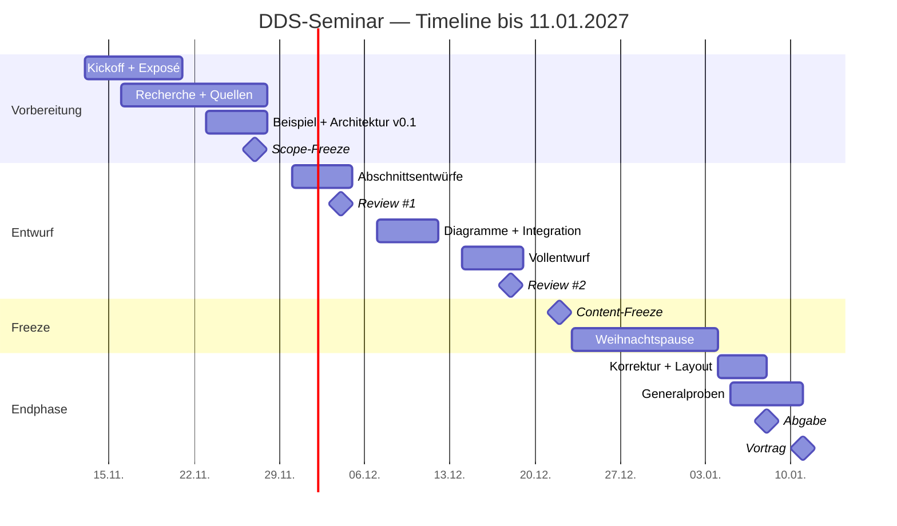
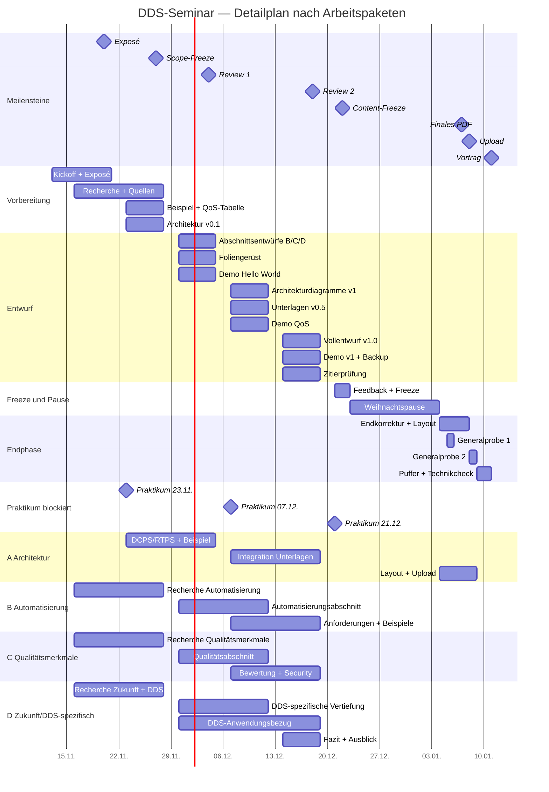

# Timeline — DDS-Seminar (WS 2026/27)

**Stand:** 25.11.2026  
**Vortrag:** Montag, 11.01.2027 (Seminar 4)  
**Abgabe der finalen Unterlagen:** Freitag, 08.01.2027, 10:00 via Ilias  
**Team:** 4 Personen · 80 Minuten (48 min Vortrag + ca. 32 min Diskussion; Ablauf noch offen)  
**Thema:** DDS-Referenzarchitektur; Assembly-Zelle und AMR-Flotte als Vergleichskandidaten, UMAA als kurzer Transferfall.

> **Rollen laut Orga-Präsentation (verbindliche Aufteilung):** A = Architektur + roter Faden + Integration/Abgabe · B = Automatisierung · C = Qualitätsmerkmale · D = Zukunft + DDS-spezifische Aspekte  
> **Status:** `[ ]` offen · `[~]` in Arbeit · `[x]` erledigt

> **Planungsbasis:** Der Gantt-Plan ist gemäß Orga-Präsentation als interner Zeitplan übernommen. Die Auswahl zwischen Assembly-Zelle und AMR-Flotte steht noch aus; UMAA ist der kurze Transferfall. Reihenfolge und Diskussionsformat bleiben Vorschläge.

---

## 1. Fixpunkte

| Datum | Was | Verbindlichkeit |
|---|---|---|
| **13.11.2026** | Initialer Plan v1.0 | Planungsbaseline |
| **23.11.2026** | Praktikum | blockiert für Seminar-Deadlines |
| **27.11.2026** | Scope-Freeze: Beispiel, Thesen, Quellen v1 | hart |
| **04.12.2026** | Internes Review #1 | hart |
| **07.12.2026** | Praktikum | blockiert |
| **18.12.2026** | Internes Review #2, Vollentwurf v1.0 | hart |
| **21.12.2026** | Praktikum | blockiert |
| **22.12.2026** | Content-Freeze v1.1 | hart |
| **23.12.2026–03.01.2027** | Weihnachtspause | keine Team-Deadlines |
| **04.01.2027** | Optionales Seminar / Wiedereinstieg | optional |
| **07.01.2027, 18:00** | Finales PDF intern fertig | hart |
| **08.01.2027, 10:00** | Upload via Ilias | **harte Abgabe** |
| **09.–10.01.2027** | Generalprobe #2, Technikcheck, Puffer | empfohlen |
| **11.01.2027** | **Vortrag** | fix |
| **25.01.2027** | Abschlusspräsentation Praktikum | danach Fokuswechsel |

---

## 2. Meilensteine

| ID | Datum | Meilenstein | Ergebnis | Owner | Status |
|---|---|---|---|---|---|
| M1 | 20.11.2026 | Kickoff + Exposé | 1 Seite: Scope, 3 Thesen, Kandidaten Assembly/AMR, Rollen | A | [~] |
| M2 | 27.11.2026 | Scope-Freeze | begründete Auswahl Assembly-Zelle vs. AMR-Flotte, Beispielspezifikation, QoS-Tabelle v0.1, Quellenregister v1, Implementierungsentscheidung | alle | [ ] |
| M3 | 04.12.2026 | Review #1 | Abschnittsentwürfe B/C/D, Foliengerüst, Demo-Hello-World | alle | [ ] |
| M4 | 11.12.2026 | Architektur v1 | Component-, Deployment-, Sequence-Diagramm, IDL-Typen | A + C | [ ] |
| M5 | 18.12.2026 | Vollentwurf v1.0 | Unterlagen vollständig, Demo lauffähig, Zitierprüfung | alle | [ ] |
| M6 | 22.12.2026 | Content-Freeze | Unterlagen v1.1, keine neuen Inhalte mehr | alle | [ ] |
| M7 | 04.01.2027 | Foliensatz v1 | 4 Einzeldeckungen auf gemeinsamem Master | jede Person | [ ] |
| M8 | 08.01.2027 | Abgabe + Generalprobe | Finales PDF hochgeladen, Timing geprüft, Q&A-Bank | A + alle | [ ] |
| M9 | 11.01.2027 | Vortrag | 80 Minuten inkl. Diskussion | alle | [ ] |

---

## 3. Wochenplan

### KW 46 — 13.11.–15.11.2026
**Fokus:** Entscheidungen, Plan, Team-Kickoff vorbereiten

- [ ] Plan v1.0 bestätigen
- [x] Thematische Rollen A/B/C/D gemäß Orga-Präsentation festlegen (bestätigt am 25.11.)
- [ ] Termin für 60-min-Kickoff festlegen
- [ ] Ordnerstruktur anlegen
- [ ] Exposé-Gerüst vorbereiten

**Output:** bestätigter Plan, Kickoff-Termin

---

### KW 47 — 16.11.–20.11.2026
**Fokus:** Kickoff, gemeinsames Verständnis, Exposé

- [ ] Team-Kickoff (60 min): Ziel, Scope, Rollen, Beispielzelle
- [ ] DDS-Grundlagen gemeinsam lesen: DCPS, QoS, Discovery, RTPS
- [ ] Vergleichskandidaten skizzieren: Assembly-Zelle und AMR-Flotte; Anforderungen und Datenströme
- [ ] Drei Thesen H1–H3 formulieren
- [ ] Quellenjagd starten: OMG-Specs, Papers, Vendor-Doku
- [ ] **M1: Exposé v1 (20.11.)**

**Output:** Exposé, erste Quellenliste, gemeinsames Glossar

---

### KW 48 — 23.11.–27.11.2026
**Fokus:** Vergleich der Anwendungsbeispiele, Architektur v0.1, Scope-Freeze  
**Achtung:** **23.11. Praktikum** — keine Seminar-Deadlines an diesem Tag

- [ ] Architekturansätze für Assembly-Zelle und AMR-Flotte vergleichen; UMAA nur als Transfer einordnen
- [ ] Beispielspezifikation v1 für den ausgewählten Fall: Teilnehmer, Topics, QoS-Klassen, Zeitbudget
- [ ] Quellenregister v1: 15–25 Quellen mit Citation-Key, Typ, Relevanz
- [ ] FOSS-DDS-Implementierung entscheiden: Fast DDS Community vs. Eclipse Cyclone DDS; Abhängigkeiten/Lizenzen prüfen
- [ ] Demo-Hello-World vorbereiten (IDL + Pub/Sub)
- [ ] **M2: Scope-Freeze (27.11.)**

**Output:** Architektur v0.1, Beispiel v1, Quellen v1, Tool-Entscheidung

---

### KW 49 — 30.11.–04.12.2026
**Fokus:** Erste Abschnittsentwürfe, Review #1

- [ ] B: Abschnitt Automatisierung entwerfen
- [ ] C: Qualitätsmerkmale und Bewertung entwerfen
- [ ] D: Zukunft/DDS-spezifische Aspekte strukturieren
- [ ] A: DCPS/RTPS-Abschnitt und Beispiel-Mapping entwerfen
- [ ] Foliengerüst pro Person (10–12 Folien)
- [ ] Demo: erster lauffähiger Pub/Sub
- [ ] **M3: Review #1 (04.12.)** — Gap-Check gegen Seminar-Brief

**Output:** vier Abschnittsentwürfe, Foliengerüst, Demo v0.1

---

### KW 50 — 07.12.–11.12.2026
**Fokus:** Integration, Diagramme, Vertiefung  
**Achtung:** **07.12. Praktikum**

- [ ] Architekturdiagramme v1: Component, Deployment, Sequence, IDL/Typen
- [ ] Unterlagen v0.5: Abschnitte zusammenführen
- [ ] C/D: Security- und TSN-Tiefe zwischen Qualitätsbewertung und DDS-spezifischem Teil abstimmen
- [ ] Demo: QoS-XML, reliable vs. best-effort, Deadline
- [ ] Quellen prüfen: mind. 2 unabhängige Quellen pro Kernaussage
- [ ] **M4: Architektur v1 (11.12.)**

**Output:** Diagramme v1, Unterlagen v0.5, Demo v0.5

---

### KW 51 — 14.12.–18.12.2026
**Fokus:** Vollentwurf, Review #2

- [ ] Unterlagen v1.0 vollständig
- [ ] Alle Diagramme final, einheitliche Notation und Legenden
- [ ] Demo v1 inkl. README und Backup-Video
- [ ] Zitierprüfung: Quellen, Bildrechte, Konsistenz
- [ ] Q&A-Bank v0.1: 20–30 Fragen nach Themen
- [ ] **M5: Review #2 (18.12.)**

**Output:** Vollentwurf v1.0, Demo v1, Q&A v0.1

---

### KW 52 — 21.12.–22.12.2026
**Fokus:** Freeze vor Weihnachten  
**Achtung:** **21.12. Praktikum**

- [ ] Feedback aus Review #2 einarbeiten
- [ ] **M6: Content-Freeze v1.1 (22.12.)**
- [ ] Keine neuen Inhalte, keine neuen Quellen
- [ ] Offene Punkte in „Parkplatz“ verschieben

**Output:** eingefrorene Unterlagen v1.1

---

### 23.12.2026–03.01.2027 — Weihnachtspause
- [ ] Keine Team-Deadlines
- [ ] Optional: leichte Lektüre, Folien laut lesen
- [ ] Erholung wichtiger als neue Inhalte

---

### KW 01 — 04.01.–08.01.2027
**Fokus:** Endkorrektur, Layout, Abgabe, Generalprobe

- [ ] 04.01.: Wiedereinstieg, offene Kommentare abarbeiten (optionales Seminar)
- [ ] 05.01.: **Generalprobe #1** mit Stoppuhr
- [ ] 06.01.: Korrekturen aus Generalprobe
- [ ] 07.01., 18:00: **finales PDF intern fertig**
- [ ] 08.01., 10:00: **Upload via Ilias**
- [ ] 08.01.: **Generalprobe #2**, Technikcheck, Q&A-Bank final
- [ ] **M7/M8: Foliensatz v1 + Abgabe**

**Output:** finales PDF, hochgeladene Unterlagen, geprobter Vortrag

---

### 09.01.–10.01.2027 — Puffer
- [ ] Letzter Timing-Check
- [ ] Backup-PDF und Demo-Video auf zwei Geräten
- [ ] Raum/Technik klären: Beamer, Adapter, Audio
- [ ] Ruhiger Sonntag

---

### 11.01.2027 — Vortrag
- [ ] 60 min vorher da sein
- [ ] Backup-PDF und Video dabei
- [ ] 80-min-Block: 48 min Vortrag + 32 min Diskussion
- [ ] **M9: Vortrag**

---

## 4. Gantt-Übersicht

### 4.1 Detail-Gantt nach Arbeitspaketen

Der Überblicks-Gantt oben zeigt die Meilensteine. Der folgende Detail-Gantt zeigt zusätzlich die parallelen Arbeitspakete pro Person und die externen Praktikumstermine.

> **Hinweis:** Der Detail-Gantt ist die übernommene Planungsbaseline. Vergangene interne Termine bleiben im Plan sichtbar; ihr Erledigungsstatus ist aus der Präsentation nicht ableitbar und muss nachgetragen werden. Bei Verzug ist der Wochenplan anzupassen.

---

## 5. Arbeitspakete nach verbindlicher Rollenaufteilung

> Die Themenverteilung folgt der Orga-Präsentation vom 15.11. und der anschließenden Bestätigung: A Architektur, B Automatisierung, C Qualitätsmerkmale, D Zukunft/DDS-spezifische Aspekte. Die Auswahl des Anwendungsfalls bleibt gesondert offen.

| Rolle | Arbeitspaket | Kernartefakte | Fällig |
|---|---|---|---|
| **A** | Architektur, roter Faden, Integration und Abgabe | DDS-/Architekturabschnitt, Vergleich des Komponenten-/Datenfluss-Mappings der Kandidaten, integrierte Unterlagen und Upload | 18.12. / 07.01. |
| **B** | Automatisierungsbezug | Bewertung der Kandidaten anhand Echtzeit, Eventmanagement, Scheduling/Synchronisation, Embedded-HW und Heterogenität; Abschnitt Automatisierung | 04.12. / 11.12. |
| **C** | Qualitätsmerkmale | Zuverlässigkeit, Leistung, Flexibilität, Robustheit, Verfügbarkeit, System-/Datensicherheit, Anpassbarkeit und Testbarkeit; begründete Bewertung | 04.12. / 11.12. |
| **D** | Zukunftsfähigkeit und DDS-spezifische Aspekte | Offenheit/Zukunft, TSN, Embedded/IoT, DDS-Datensicherheit und Anwendungsbezug; Fazit/Ausblick | 04.12. / 18.12. |
| **noch festzulegen** | Demo-Verantwortung | Demo-Scope und technische Zuständigkeit passend zum gewählten Fall bestimmen | Scope-Freeze |
| **alle** | Unterlagen, Folien, Q&A, Proben | gemeinsamer Master, Q&A-Bank | 08.01. |

---

## 6. Kritischer Pfad und Puffer

**Kritischer Pfad:**

1. Vergleich und Auswahl des Anwendungsfalls; Beispielspezifikation (27.11.)
2. Architekturdiagramme v1 (11.12.)
3. Unterlagen v1.0 (18.12.)
4. Content-Freeze (22.12.)
5. Finales PDF (07.01.)
6. Upload (08.01.)

**Puffer:**

- 09.–10.01.2027 als technischer und inhaltlicher Puffer
- Demo ist **nicht** kritisch: Backup-Video und Code-Ausschnitte reichen als Fallback
- Quellenregister hat keinen Puffer mehr nach dem 27.11. → früh starten

---

## 7. Offene Entscheidungen

| Entscheidung | Empfehlung | Status |
|---|---|---|
| Anwendungsfall | Assembly-Zelle vs. AMR-Flotte begründet vergleichen; UMAA kurzer Transfer | [~] |
| Rollenaufteilung | A Architektur, B Automatisierung, C Qualitätsmerkmale, D Zukunft/DDS-spezifisch | [x] |
| AMR-Umsetzungsprofil | direkte DDS-API ohne ROS 2 | [x] |
| AMR-Lizenzanforderung | FOSS; kommerzielle Erweiterung keine Voraussetzung | [x] |
| DDS-Implementierung | Fast DDS Community (Apache-2.0) vs. Eclipse Cyclone DDS (EPL-2.0/EDL-1.0) | [ ] |
| Umfang Unterlagen | 15–20 Seiten + Anhang | [ ] |
| Diskussionsformat | 48 + 32 als Vorschlag der Orga-Präsentation; 4 × (12 + 8) als Alternative | [ ] |
| UML-Werkzeug | Visual Paradigm, Export PNG/SVG | [ ] |
| Sprache | Deutsch | [ ] |
| Genaues Zeitfenster am 11.01. | beim Lehrstuhl erfragen | [ ] |
| Erreichbarkeit 23.12.–03.01. | im Team klären | [ ] |

---

## 8. Nächste Schritte

- [x] Plan v1.0 bestätigen
- [x] Ordnerstruktur anlegen: `01_plan`, `02_quellen`, `03_architektur`, `04_demo`, `05_unterlagen`, `06_folien`, `07_qa`
- [x] Exposé-Gerüst mit H1–H3 erstellen
- [ ] Assembly-Zelle und AMR-Flotte vergleichend spezifizieren
- [x] 80-Minuten-Agenda erstellen
- [ ] Quellenregister starten
- [ ] Team-Kickoff terminieren; Rollen A–D sind thematisch festgelegt
